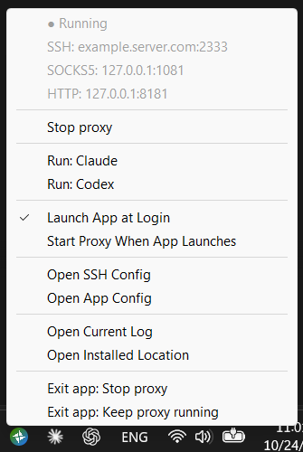

# SSH Proxy

**Using SSH Proxy?** See the [中文使用指南 / English guide](src/packaging/defaults/README.md).

---

SSH Proxy runs local HTTP/HTTPS and SOCKS5 proxies through native OpenSSH. It ships two programs as a portable ZIP:

- **`ssh-proxy-cli`** (Windows, macOS, Linux) owns the proxy.
- **`ssh-proxy-app`** (Windows, macOS) is a tray GUI built on the CLI. The CLI never depends on the app.



Prefer existing libraries, small adapters and sensible defaults over new abstractions or settings. Start with [build and release](#build-and-release), then follow the [development checks](#test-and-verify).

## Architecture

```text
HTTP/HTTPS client ─> Go HTTP proxy :8181 ─> SOCKS5 dialer ─┐
SOCKS5 client ─────────────────────────────────────────────┤
                                                           v
                              native OpenSSH  ssh -N -D :1081 ─> SSH server ─> destination
```

- **OpenSSH** owns encryption, authentication, host trust and the SOCKS server. The tunnel only needs SSH TCP forwarding. `login` and `login --check` (which the tray runs before Start, and `autostart enable` runs too) run a command on the server, so the account needs a shell; key setup needs a POSIX shell.
- **The Go bridge** forwards HTTP and HTTPS `CONNECT` through SOCKS with remote DNS. It does no TLS interception and has no direct-connection fallback.
- **Out of scope:** UDP, VPN routing and mixed-port mode.

| Responsibility | Implementation |
| --- | --- |
| SSH, SOCKS server | native `ssh` (`-F`, `-G`, `-D`), OpenSSH 8.7+ |
| HTTP, CONNECT, WebSocket, streaming | `elazarl/goproxy` |
| SOCKS client | `golang.org/x/net/proxy` |
| Configuration | `BurntSushi/toml`, `trzsz/ssh_config`; `ssh -G` resolves effective settings |
| CLI | `spf13/cobra` |
| Tray | `gogpu/systray`, native dialogs and file openers |
| Login startup | Windows HKCU Run values, macOS LaunchAgents, Linux systemd user units |
| Process ownership | Windows mutex and Job Object; Unix `gofrs/flock`, sessions and the `_ssh` guardian |
| Test SSH server (tests only) | `gliderlabs/ssh`, `x/crypto/ssh` |

All builds use `CGO_ENABLED=0` and native tools (no WSL).

## Source map

| Path | Responsibility |
| --- | --- |
| `src/cmd/ssh-proxy-cli`, `src/cmd/ssh-proxy-app` | The two entry points |
| `src/cli` | Cobra commands, flags, help and reports |
| `src/config` | TOML, install paths and identity, SSH aliases, `ssh -G`, SSH arguments, `app.json` |
| `src/bridge` | HTTP-to-SOCKS bridge, connection tracking, health probes |
| `src/supervisor` | Supervisor run, SSH lifecycle, readiness, health, failover, background start/stop |
| `src/control` | `state.json`, the authenticated local API and `status` |
| `src/platform` | Locks, detaching, child containment, Unix SSH guardian, login registration |
| `src/logs` | Run logs, retention and size limits |
| `src/ui` | Tray controller, menu, setup terminal, dialogs, app login item, scripts |
| `src/packaging` | Public defaults: config templates, user guide, screenshot, launchers, and  executable resources |
| `scripts` | Build and test scripts |
| `tests/unit`, `tests/system`, `tests/helpers` | Flat test suites and shared fixtures |

Keep dependencies one-way: `platform` is the foundation; `config`, `logs` and `bridge` support `control` and `supervisor`; `cli` coordinates them. Lower-level packages never import the CLI or UI. The tray uses `config`, `control`, `platform` and `logs`, invokes the CLI for validation, login setup and start/stop, and queries the authenticated control API in-process. Internal `_run` (supervisor) and `_ssh` (Unix guardian) modes reuse the CLI executable.

## Design

### Configuration and SSH

`config.toml` lives beside the CLI, regardless of the working directory; there is no config-path flag. Relative paths resolve from that folder, logs go to `logs/`, and native SSH runs from the SSH config's folder. Invalid values are rejected; settings the program doesn't use are ignored. Defaults live only in the template: `EnsureConfig` adds missing settings before any command loads the file, so `LoadConfig` has no built-in defaults. See the [template](src/packaging/defaults/support/config.toml.in).

Packages ship only the templates `support/config.toml.in` and `support/ssh_config.in`, never the user's files, so unzipping a new version over an installation keeps the user's settings. Before any command that reads the configuration (`check`, `start`/`restart`, `login`, `test`, `autostart enable`, `_run`; the tray's launch `check` included), `config.EnsureConfig` runs silently (`src/config/templates.go`): it copies every `support/NAME.in` to `NAME` when `NAME` is missing, and merges an existing `config.toml` with the template, adding new settings and keeping every existing entry, including unused or invalid ones (validation reports invalid values). It rewrites the file only when settings were added, and comments are then lost; a uniquely named temporary file lets the tray and CLI autostart upgrade at the same moment. Invalid TOML is left for validation to report. `status`, `stop`, `logs` and `autostart disable`/`status` never touch files. `support/` is part of every installation: a missing template stops the command with an error asking to extract the full release again. Tests that build an install folder add the templates with `testutil.Support`.

Endpoints are the concrete `Host` aliases declared in the selected SSH config, in first-appearance order without duplicates. Wildcards, exclusions and `Match` add no targets. `Include` can supply settings, but its aliases are not enumerated as targets. Native `ssh -G` resolves effective settings, including `ProxyJump` and authentication; do not reimplement it.

Managed tunnels enforce batch authentication, strict host-key checking, no TTY or agent forwarding, no authentication forking or multiplexing, and `ExitOnForwardFailure`. One matching `DynamicForward` is reused; conflicting or multiple forwards and `ClearAllForwardings yes` are rejected. Host trust uses OpenSSH's default files.

`login` is a guided setup that skips steps already done (`src/cli/setup.go`): if unattended login already works it exits 0; otherwise it uses the first existing key from `ssh -G`'s `identityfile` list (a path with `%` tokens or `${}` variables, which `ssh -G` leaves unexpanded, is refused), or creates one without a passphrase (a configured custom path, else OpenSSH's default `~/.ssh/id_ed25519`, so no `IdentityFile` is needed), using `ssh-keygen` beside the configured `ssh`. It then logs in interactively, without forwarding, and appends the public key's type and data to the remote `~/.ssh/authorized_keys` unless present (POSIX shell assumed; nothing from the key comment reaches the remote command). It checks unattended login again, offers `ssh-add` for a passphrase-protected key, and on failure prints the public key for the administrator. It never stores passwords, and only OpenSSH prompts, so the tray's setup terminal runs the same `login`. `login --check` only verifies the tunnel's unattended authentication policy and changes nothing. `--log FILE` also appends login's own messages, without piping terminal input; OpenSSH's messages stay on the terminal, except that `--check` has `ssh -E` append them to the file. A login that fails in a Windows console of its own, such as the tray's setup window, waits for Enter before the window closes.

### One supervisor per install

The installation identity is the first eight SHA-256 bytes of the cleaned absolute TOML path, case-folded on Windows. It scopes locks, login entries and runtime state in the user cache (`%LOCALAPPDATA%\ssh-proxy\<id>` on Windows; on Linux `~/.cache` even when `XDG_CACHE_HOME` is set, because the systemd user manager that runs autostart may not see it). `SSH_PROXY_RUNTIME` isolates unit tests; each system test copies the build to its own folder, which gives it its own identity, so system tests can run in parallel.

All entry points use the same supervisor. Background `start` launches detached `_run`; foreground starts run in the calling terminal. Only the instance-lock holder creates the run log and publishes state. Concurrent background starters join the winner through its control API; a losing `_run` exits with code 10 without creating a log, and its starter reports the winner's startup failure as soon as it is recorded. A `stop` that arrives while `start` still waits for readiness is a requested stop, not a failed start. A duplicate foreground start fails without touching live state. `restart` validates configuration before stopping anything.

`--wait` bounds the readiness wait, not the supervisor's lifetime. Control-API initialization gets up to 30 extra seconds. A successful `start` can report `connecting` or `reconnecting`; callers must inspect the phase.

`state.json` contains the PID, config/log paths, an ephemeral loopback address and a random token. The only API routes are authenticated `GET /status` and `POST /stop`; requests bypass environment proxies. Only the instance-lock holder writes or deletes this file. The lock, not a PID from a possibly stale file, says whether a supervisor runs: `stop` waits up to 30 seconds for a lock holder that has not published its API yet, and Windows `status` checks the lock because Windows reuses PIDs quickly. Unix `status` keeps the PID check, since probing the lock while polling could delay a starting supervisor.

| Exit | State and diagnostics |
| --- | --- |
| Requested stop: `/stop`, Ctrl+C, SIGTERM | Remove state; report `stopped` without a failure |
| Startup failure, server failure or recovered panic | Write an exit record containing time, reason and run log |
| Fatal crash or hard kill | Leave state; report an unexpected stop (on Unix, `unresponsive` if the PID was reused); `stop` takes the free lock and clears it |
| Hung supervisor | Report `unresponsive`; `stop` fails after 30 seconds without killing; recovery is manual |

The next successful start replaces old diagnostics. Parents reuse a child's log and exit record; only failures before the child owns diagnostics allocate a parent-written failure log. Temporary bootstrap output stays in the runtime folder. Fatal panics go to the run log through `debug.SetCrashOutput`; recovered panics explicitly log `debug.Stack()`.

On Windows, a kill-on-close Job Object contains SSH. Background launch attempts job breakaway; if the caller's job forbids it, closing that job can still stop the proxy. On Unix, background launch detaches into a new session, and the `_ssh` guardian ends SSH when the supervisor's pipe closes. The guardian leads its own process group and runs SSH in another, so it also ends a ProxyCommand or ProxyJump process SSH started, and a closed terminal or launchd's job cleanup cannot kill it first. The guardian gives SSH a 1024-file limit instead of macOS's default 256, since each proxied connection holds one. A stale PID never authorizes a kill; never kill by process name.

### Connection lifecycle

Startup checks that the SOCKS port is free, reserves the HTTP listener, then tries aliases in order. OpenSSH owns the SOCKS listener. Readiness requires forwarding to at least one health target; HTTP returns 503 until ready. SSH exit triggers cleanup and the next alias. After every alias fails, the supervisor waits `retry_delay_seconds` and retries indefinitely.

Failed probes on a live tunnel mark it `degraded`; switching on probe failures is opt-in. A healthy backup does not automatically fail back. Stop and failover close tracked connections and the HTTP idle pool; clients reconnect.

The HTTP bridge preserves `Accept-Encoding` and response bytes, aborts incomplete upstream bodies, and flushes headers immediately for SSE and responses without `Content-Length`. It serves HTTP requests full duplex, so a response that arrives before the upload ends, such as a 413, reaches the client at once. It keeps up to 100 idle upstream connections, both total and per host. Connection setup has a 30-second budget; probes use their own deadline. Established transfers and tunnels have no lifetime timeout.

Preserve CONNECT buffered bytes and half-close, streaming flushes and trailers, WebSocket cleanup, client cancellation, and the generation check that rejects dials completing after a tunnel replacement.

### CLI contract

- **JSON output:** `status` and `check` print JSON; there's no `--json` flag.
  - `status` includes `autostart`, read without starting a process.
  - `status --proxy-http` or `--proxy-socks` (mutually exclusive) prints only the `http://` or `socks5h://` URL while `running` or `degraded`. Otherwise it prints nothing and exits 0.
  - `check` exits 0 even when `valid` is false. `incomplete: true` marks unfinished setup rather than a mistake: `ssh_config` has no server yet, or is missing (`config.ErrNoHosts`).
- **Errors** go to stderr with a nonzero exit. Help and version return before any config or OS access.
- **Flags and help** live in `src/cli/cli.go`. Root help lists each command's own flags; `autostart --help` has the login-startup details.
- **Rejected commands** (keep the tests): plain `help` and `version`, `--json`, tray-management commands, and every `service …` command.

### Login startup

| Entry | Owner | Windows | macOS | Linux |
| --- | --- | --- | --- | --- |
| Proxy at login | CLI `autostart enable/disable/status` | HKCU Run `SSHProxyCLI-<id>`: `ssh-proxy-cli.exe start --wait 1` | LaunchAgent `com.sshproxy.cli.<id>`: `start --foreground` | systemd user unit `ssh-proxy-<id>.service`: `start --foreground`, `Restart=no` |
| App at login | App menu "Launch App at Login" | HKCU Run `SSHProxy-<id>`: the app exe | LaunchAgent `com.sshproxy.login.<id>` | (no app) |

- **Independent and safe together:** the two entries are independent, and starting twice is harmless because a second start joins the first.
- **What the CLI entry does and doesn't do:**
  - `enable` validates the config and warns, without failing, when `login --check` fails; it doesn't start the proxy now.
  - `disable` leaves the running proxy alone. On macOS, that means removing the plist without `bootout`.
  - No elevation, stored password, pre-login start or OS restart policy.
- **Windows long-path fallback:** a Run command over 260 characters becomes a hidden PowerShell launcher that reads its own key (`HKCU\Software\SSHProxy\CLI-<id>` or `App-<id>`). The key is deleted when unused.
- **Repair:** the app rewrites an old-format app entry at the same location when it starts.
- **Folder moves change `<id>`,** so users disable any enabled login startup entries before moving and enable them again afterwards. Registration doesn't detect disabling in OS settings, for example Task Manager.

### Tray

The app takes no arguments and locates the adjacent CLI, including from its macOS bundle. Its controller polls about every two seconds, serializes actions, and changes native menu items only when their values change. The status rows show SSH host:port, SOCKS5 and HTTP addresses.

Start runs `check`, then silent `login --check`. An `incomplete` result (no SSH server yet, as on first launch) only opens `ssh_config` at launch and on every Start, starting a missing file from `support/ssh_config.in`. It shows no error dialog or log; the template's first lines explain why it opened. Other invalid configs show the error dialog and open the failing file once per run. A failed check re-reads status before opening setup, so CLI autostart can proceed without a competing terminal. Setup opens only when OpenSSH reports `Permission denied` or `Host key verification failed`; any other failure, such as a network or VPN that is not up yet, starts the proxy, which keeps retrying. Setup uses a native Windows console or macOS Terminal via AppleScript; macOS may require Automation permission. A failed setup keeps its window open: the Windows console waits for Enter, and macOS leaves the Terminal window. After setup, the silent check runs again because password-only login cannot run unattended. Failed setup waits for another Start action; an already-started supervisor keeps retrying connections independently. The tray runs its CLI commands other than `start` contained (a Windows job, a macOS process group), so closing the app also ends a check's `ssh`; `start` stays uncontained because its supervisor must survive.

**Start Proxy When App Launches** reuses that flow. Its `start_proxy_on_launch` setting lives in `app.json` beside the TOML, defaults to false when absent, and is rewritten as a whole file. CLI autostart ignores it. Stop-and-exit waits for successful CLI stop; failure keeps the app open. Keep-proxy-running exits only the tray.

Failed actions and invalid configs show their reason and open the tray run log. The supervisor's own errors while it retries (reconnecting, degraded) appear only in the tooltip and the tray log, never as dialogs. The tray alerts once when a supervisor observed alive becomes an unclean stopped run, opening that proxy's log. It does not alert for old failures or normal stops. Login-registration repair failures are logged without preventing app launch.

Configs and logs open as text regardless of extension: Windows uses the `.txt` association with a Notepad fallback; macOS uses `open -t`. Folders use the file manager. Scripts are discovered once at startup (`.ps1` on Windows, `.sh` on macOS), run non-interactively, and write output straight to the tray log file, so a process a script leaves running cannot keep the tray busy. Subfolders of `scripts/` are not listed. The bundled launchers keep only their user-editable values (default `SSH_PROXY_URL`, the `CODEX_APP`/`CLAUDE_APP` fallback) and app candidates, then call the shared `scripts/utils/launch-app.ps1` or `launch-app.sh`. It uses `status --proxy-http`, falling back to the default URL, and starts the first installed candidate before the fallback. On macOS it writes the app's output to `logs/claude.txt` or `logs/codex.txt`, overwritten at each launch. On macOS and Linux, `run-via-proxy.sh [--proxy-http URL] APP [ARGS...]` at the folder root sets the proxy variables from `status --proxy-http`, or the given URL, and runs the program in place with its arguments.

### Logs

- **One file per run:** each tray or proxy run writes one continuous file in `logs/`. Retention keeps `max_log_files` per kind (tray, proxy) across identities, never deletes a file still in use, and ignores unrelated files. The instance lock is taken before the log is created.
- **Size limit:** above `max_size_mb`, the owner removes the older half in place and marks the cut. Truncation is held while `login` or `ssh -E` append. The cut marker records the cut time, so `logs --follow` notices every cut, prints a notice and continues from the end; lines written during the cut may not be shown.
- **Unreadable TOML:** config failures are still logged, using the default limits.

## Build and release

Requirements:

- Python 3.10+. Tests also need native OpenSSH 8.7+: the runners put the first such `ssh` first on `PATH` (on Windows, a newer install wins over System32's, and Git's MSYS `ssh` is skipped).
- No C compiler. Building and testing need no pip packages; `requirements.txt` serves only macOS app tests and icon rendering.
- `build.py` uses a Go version that satisfies [go.mod](go.mod), or downloads one into `.build-tools` with SHA-256 verification.

Targets:

- Windows 10+, macOS 13+ and Linux, on amd64 and arm64.
- The app builds only for Windows and macOS.
- A cross-build proves compilation only, not runtime behaviour.
- Don't build macOS during Windows development unless asked.

`--os` accepts `windows`, `darwin` or `linux`; `--arch` accepts `amd64` or `arm64`. Both default to the build host.

```sh
python scripts/build.py                                   # build/ssh-proxy-<os>-<arch>/
python scripts/build.py --out build/scratch               # while build/ssh-proxy-<os>-<arch> is running
python scripts/build.py --release --out build/release     # clean folder: build/release/ssh-proxy-<os>-<arch>/, .zip and .sha256
python scripts/build.py --release --os linux --arch arm64 --out ./packages
```

- **Every build** writes the whole payload into `<out>/ssh-proxy-<os>-<arch>/` from the public defaults: programs, guide, the whole `scripts/` folder of launchers on Windows and macOS (the tray lists only the platform's own `.ps1` or `.sh` files), `run-on-mac.sh` on macOS, `run-via-proxy.sh` on macOS and Linux, `.version` and `support/`. Files outside the payload are never touched: the user's `config.toml` and `ssh_config` (created from `support/*.in` at first run), app settings, logs and own scripts. A dev build therefore keeps your configs, just like unzipping a release over an installation.
- **`--release`** also creates `<out>/ssh-proxy-<os>-<arch>.zip`, whose root folder has the same name, and its `.sha256` (`sha256sum -c`). Names carry no version, so unzipping a new release over an installation keeps its folder. The release first checks that the build folder holds exactly the payload and an empty `logs/`. Any other file or folder, such as a `config.toml`, `ssh_config`, app settings or logs from a folder that was used, fails the build with a list of the files, and no ZIP is made (an older ZIP is removed). Release into a clean `--out`, for example `build/release`.
- **Private files and output:** `build/` and `.build-tools/` are git-ignored. Keep real configs and logs there, outside public defaults.
- **Versioning:** [.version](.version) is the only version source; change it only on request.
- **Packaging** copies [LICENSE](LICENSE) to `support/LICENSE.txt` and generates `support/BUILDINFO.txt` (`go version -m` output, including the commit Go stamps as `vcs.revision` and `vcs.modified=true` for uncommitted changes), `support/THIRD_PARTY_NOTICES.txt` (only for modules linked into that target) and `support/SHA256SUMS`, which covers only the program binaries, with paths relative to the install folder (`sha256sum -c support/SHA256SUMS`). Packaged text files must use LF, as git checks them out; the build stops if an editor saved one with CRLF.
- **Windows resources:** `go-winres` (pinned in `go.mod`) embeds them before hashing: the app icon at each size, and a manifest that makes the app per-monitor DPI-aware so its tray icon and dialogs stay sharp at any display scaling.
- **macOS:** the `.app` stays beside the CLI and configs, and its plist declares macOS 13.
- **Signing:** packages are unsigned and not notarized.
- **The builder never runs tests.**

## Test and verify

Follow [AGENTS.md](AGENTS.md). Run scripts from the repository root in a visible native terminal; use `python3` on macOS/Linux if needed. `visible.py` opens a new terminal window titled with the run name (PowerShell on Windows, Terminal on macOS, the desktop's terminal emulator on Linux: `$TERMINAL`, then `x-terminal-emulator`, GNOME Terminal, Konsole and other common ones) and closes it after completion. Without a desktop display, or on macOS when the program running it may not control Terminal, it runs in the current terminal. The command keeps the caller's `PATH`, so an active virtual environment still applies. It saves output and exit status under `build/test-results/<name>-<stamp>/`, prints the last output lines on failure, and with `--no-wait` returns at once.

```sh
python scripts/visible.py --name unit  -- python scripts/run-unit-tests.py
python scripts/visible.py --name build -- python scripts/build.py
python scripts/visible.py --name cli   -- python scripts/run-sys-tests.py --cli-only
python scripts/visible.py --name app   -- python scripts/run-sys-tests.py --app-only
python scripts/visible.py --name retry -- python scripts/run-sys-tests.py --app-only --test TestTrayNativeWorkflow
```

| Change | Checks |
| --- | --- |
| CLI or backend Go | Unit tests and a build; CLI system tests when asked |
| Tray Go | Unit tests and a build; app system tests when asked |
| Shared Go or the system-test runner | Both system-test scopes, when asked |
| Packaging | Run the affected build or release path |
| Scripts or docs only | Checks scoped to the change; no app build or Go suites |

- **Unit runner:** checks modules and formatting, runs `go vet` and staticcheck for Windows, macOS and Linux, then runs the host's unit tests.
- **CLI output snapshot:** `tests/unit/testdata/cli/expected.txt` records each distinct help or error output. After an intended change, regenerate it with `SSH_PROXY_UPDATE_EXPECTED=1` and review the diff.
- **System runner:** tests an existing build; use `--build-dir build/scratch/ssh-proxy-<os>-<arch>` for a separate one.
  - It tests the selected build’s binaries with current source defaults, not preserved files in an existing dev folder. Release packaging separately verifies default file contents and writes only the declared ZIP payload.
  - With no scope it runs everything the platform supports. `--app-only` needs the CLI too, and Linux has no app tests.
  - `--test NAME` reruns one top-level test, with its subtests; an unknown name fails. After a failure, fix and rerun only that test.
  - Default runs use isolated configs, runtime folders, throwaway SSH keys and a local SSH server. They do not stop the user’s proxy or change host trust.
  - `--live-config PATH` adds checks against real endpoints; it can't be combined with `--app-only`.
  - Autostart tests use isolated entries and launch them through launchd, systemd or the stored Windows Run command. Windows also needs one manual check with a real sign-in.
- **Platform needs:**
  - **App tests:** an unlocked desktop and a default text editor.
  - **macOS:** install `requirements.txt` in a virtual environment. From Terminal, run `python3 -m venv build/venv`, `source build/venv/bin/activate`, then `python -m pip install -r requirements.txt`. `visible.py` runs the tests in a Terminal window, so Terminal needs Accessibility, and Automation for System Events, Terminal and TextEdit; the app that calls `visible.py` (an agent or another terminal) needs Automation for Terminal. The runner requests these and waits for approval. When the calling Python lacks the packages, the runner switches to `build/venv/bin/python` itself. Other default text editors must expose opened document names in their window titles.
  - **Windows and Linux:** no Python packages. Linux autostart tests need a working systemd user session.
- **Results:** output, JSON events and summaries are saved under `build/test-results/`. Every selected test must pass; only the unrequested live-endpoint test may skip. Native runs are required to validate each OS; Windows results do not certify macOS or Linux.

## Documentation and assets

- **Where docs go:** design and build go here. Usage goes only in the [user guide](src/packaging/defaults/README.md), Chinese first and English second, with both updated for every user-visible change. Public defaults must not contain real hosts, usernames, keys or logs.
- **Icon:** `scripts/render-icons.py` holds the design: a white paper windmill on a green-to-blue disc. Its colors keep at least 3.7:1 contrast on dark and light taskbars and behind the white windmill. The script writes `src/ui/icon.svg` and renders every icon at its exact size, drawing sizes up to 64 px on whole pixels so tray icons stay crisp: `src/ui/icons/icon-N.png` holds the Windows notification-area sizes for 100–350% scaling (the tray picks the size Windows reports), 44 px for the macOS menu bar's 22 pt at 2x, and the Windows app icon sizes listed in `src/packaging/windows-icon.json`; `src/ui/icon.icns` is the macOS app icon. After changing the design, install `requirements.txt` in a virtual environment and rerun it (on Windows use `build\venv\Scripts\python`):

```sh
python3 -m venv build/venv
build/venv/bin/python -m pip install -r requirements.txt
build/venv/bin/python scripts/render-icons.py
```

## License

SSH Proxy is licensed under the [Apache License 2.0](LICENSE).
